# Avgust Familiar

**Русский** · [English below](#english)

<picture>
  <source media="(prefers-color-scheme: dark)" srcset="screenshots/ru/home-dark.png">
  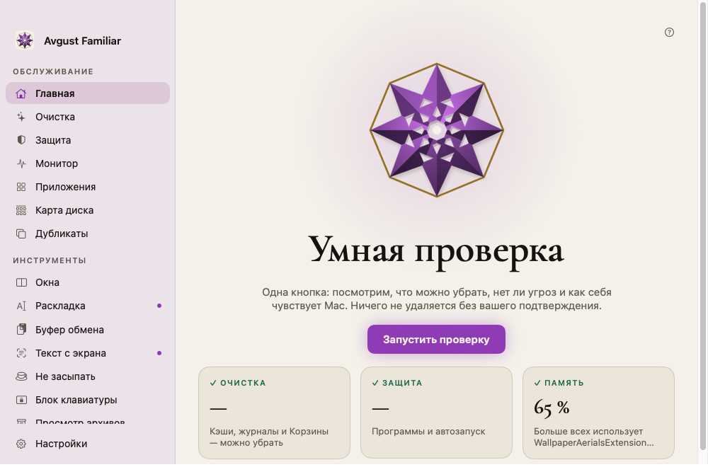
</picture>

Спокойный помощник для Mac, который живёт в строке меню. Один значок вместо набора мелких утилит: окна, раскладка и
сниппеты, буфер обмена, очистка, защита, монитор, приложения, карта диска, дубликаты, текст с экрана, «Не засыпать»,
блок клавиатуры и просмотр архивов. Ничего не уходит в интернет, кроме проверки обновлений на GitHub.

- **Скачать:** [последний выпуск](https://github.com/aaavgust/AvgustFamiliar/releases/latest) — файл `AvgustFamiliar-1.0.0.dmg`
- **Сайт автора:** [aaavgust.github.io](https://aaavgust.github.io)
- **Обратная связь:** [a_a_avgust@icloud.com](mailto:a_a_avgust@icloud.com)

## Что умеет

| Раздел | Что делает |
| --- | --- |
| Главная | «Умная проверка»: очистка, защита и монитор одной кнопкой |
| Очистка | Кэши, журналы и временные файлы простыми словами, с пометками «безопасно», «на ваше усмотрение», «защищено» |
| Защита | Опасным считается только настоящее вредоносное ПО; программы без подписи показываются отдельно и спокойно |
| Монитор | Процессор, память, диск, сеть, датчики; завершить можно только обычные программы, не системные |
| Приложения | Что давно не открывали; удаление вместе со служебными файлами программы |
| Карта диска | Что занимает место во всей домашней папке или на выбранном диске, прямоугольниками по размеру |
| Дубликаты | Одинаковые файлы, сравнение по содержимому |
| Окна | Прилипание к краям и углам экрана при перетаскивании, горячие клавиши для половин, четвертей и полного экрана |
| Раскладка | Исправляет «ghb» → «при» прямо при наборе; универсальная клавиша (по умолчанию нажатие Fn); сниппеты через `]` |
| Буфер обмена | История с текстом, картинками и файлами; окно у курсора по ⌘⇧V, стрелки, Enter, цифры 1–9 |
| Текст с экрана | Выделите область — текст окажется в буфере обмена |
| Не засыпать | Mac не уснёт: на время, до конкретного часа или пока работает выбранная программа |
| Блок клавиатуры | Временно отключает клавиатуру, чтобы её протереть |
| Просмотр архивов | ZIP, TAR, 7z, RAR и другие — содержимое по пробелу, без распаковки |

Ещё снимки экрана

| | |
| --- | --- |
| 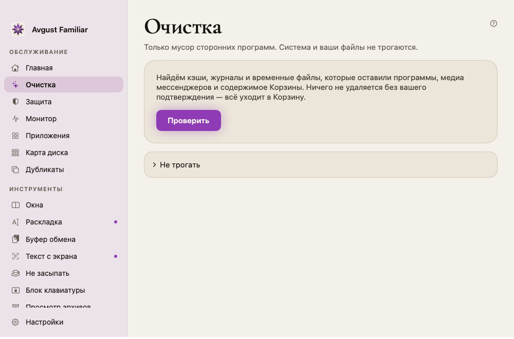 | 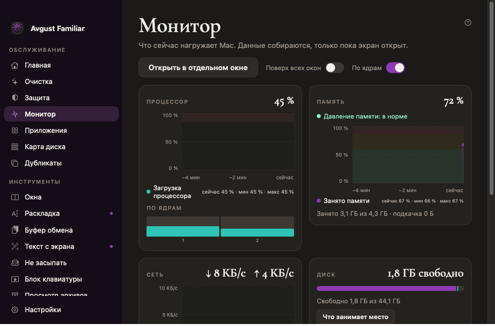 |
| 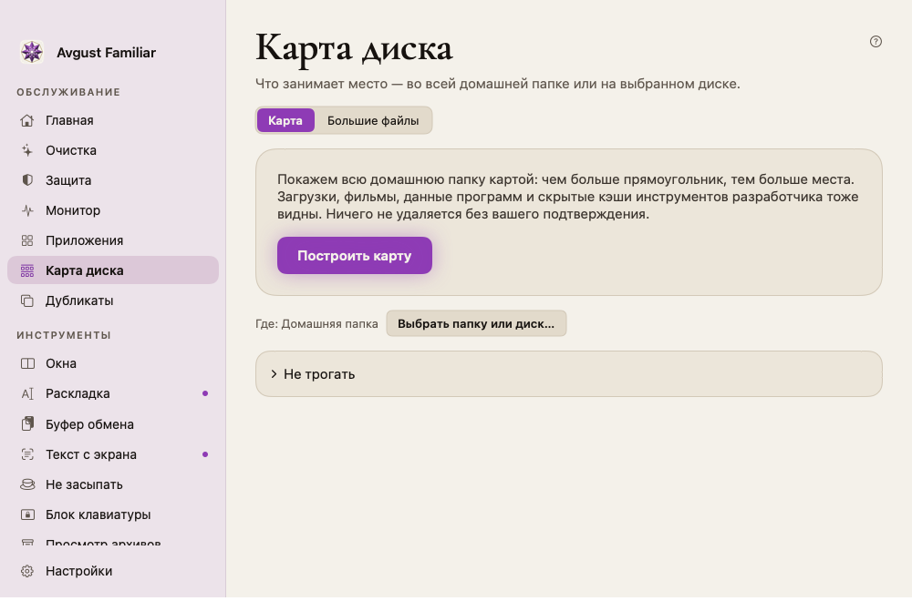 | 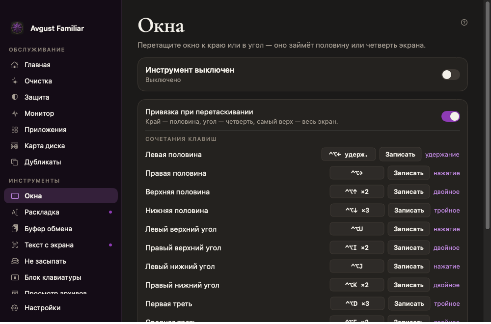 |
| 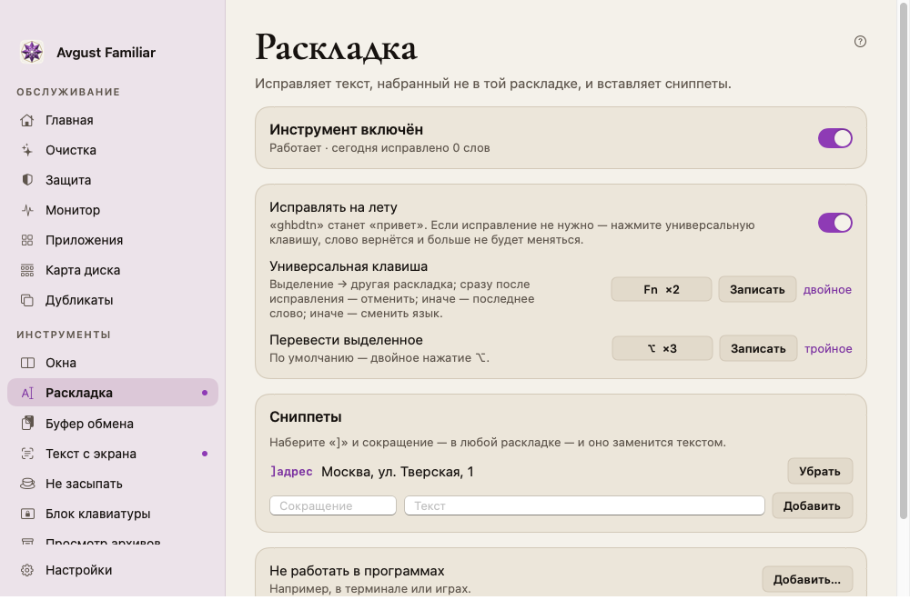 | 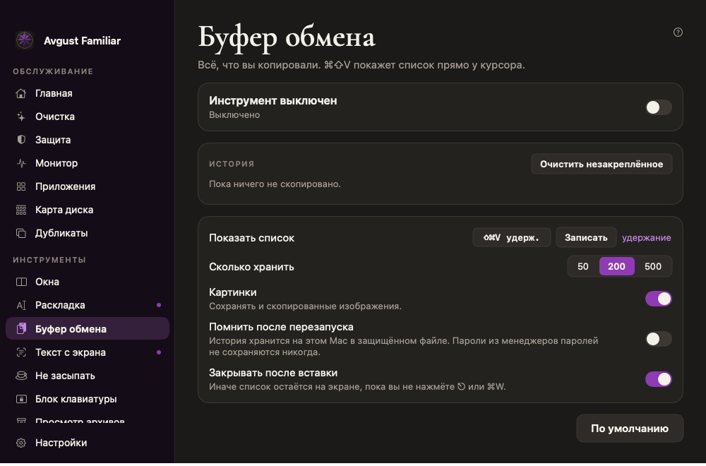 |
| 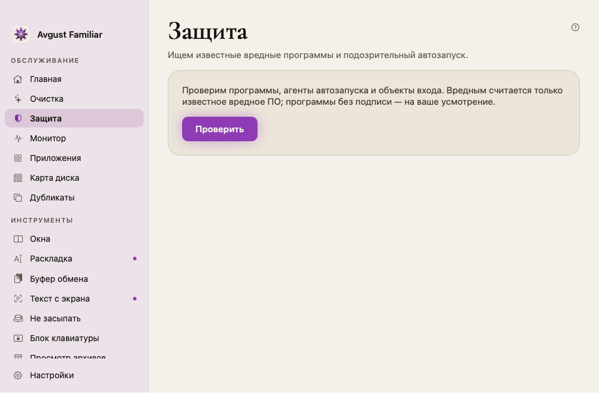 | 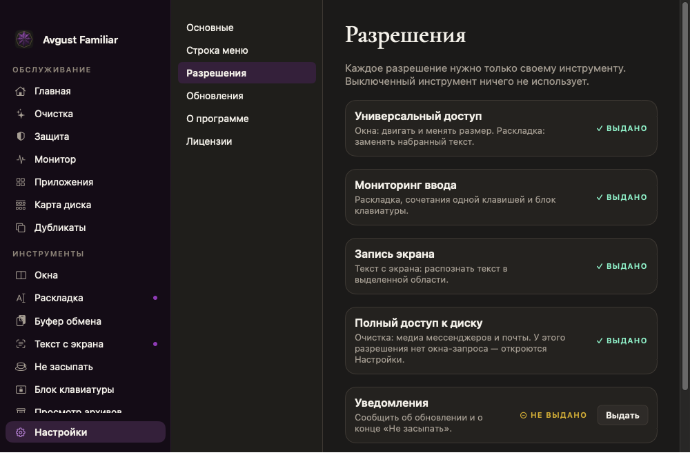 |

## Системные требования

- macOS 15 Sequoia или новее.
- Mac с процессором Apple (M1 и новее). **Mac с процессором Intel не поддерживаются.**
- Около 10 МБ на диске.

## Установка

1. Скачайте `AvgustFamiliar-1.0.0.dmg` со страницы [последнего выпуска](https://github.com/aaavgust/AvgustFamiliar/releases/latest)
   и откройте его. Перетащите **Avgust Familiar** в папку «Программы».

   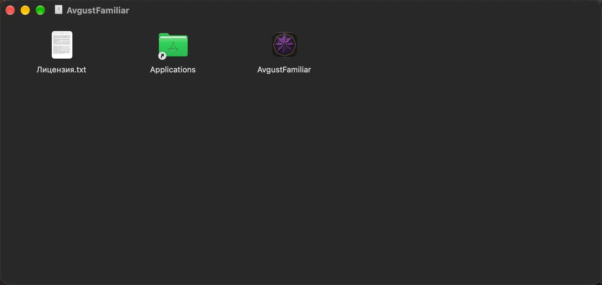

2. Запустите Avgust Familiar из «Программ». **Честно о подписи:** приложение подписано моим собственным
   сертификатом и не проходило нотаризацию Apple (это платная программа для разработчиков). Поэтому при первом
   запуске macOS его остановит и скажет, что не может проверить разработчика. Это ожидаемо — нажмите «Готово».

3. Откройте **Системные настройки → Конфиденциальность и безопасность**, пролистайте до раздела «Безопасность»
   и нажмите **«Всё равно открыть»** рядом с сообщением об Avgust Familiar. Подтвердите паролем Mac.
   Так нужно сделать только один раз.

4. Появится приветствие: язык, разрешения и какие инструменты включить. Значок приложения — в строке меню.

Обновления приходят сами: **Настройки → Обновления** (проверка раз в день включена, автоустановка выключена).
Каждое обновление подписано ключом автора, и приложение не установит файл с чужой подписью.

## Разрешения

Нужны только тем инструментам, которые вы включили. Выдаются из приветствия или в **Настройки → Разрешения**;
приложение объясняет каждое и работает без тех, что вы не дали.

| Разрешение | Зачем | Каким инструментам |
| --- | --- | --- |
| Универсальный доступ | Двигать окна, заменять набранный текст, вставлять из буфера | Окна, Раскладка, Буфер обмена |
| Мониторинг ввода | Видеть набранные слова и сочетания одной клавишей | Раскладка, Блок клавиатуры |
| Запись экрана | Распознать текст в выделенной области | Текст с экрана |
| Полный доступ к диску | Медиа мессенджеров и вложения почты; без него такие папки просто пропускаются | Очистка, Карта диска |
| Уведомления | Сообщить о новой версии и о конце «Не засыпать» | Обновления, Не засыпать |
| Автоматизация («События системы») | Прочитать и убрать объекты входа | Защита, Приложения |

## Конфиденциальность

Приложение ничего не собирает и ничего не отправляет. Единственное обращение в сеть — проверка новой версии на GitHub.
Настройки, история буфера обмена (если вы её включили) и результаты проверок хранятся только на вашем Mac. Отчёт о сбое
уходит автору, только если вы сами нажмёте «Отправить отчёт автору»: письмо откроется в вашей почте. Подробно — в
[PRIVACY.md](PRIVACY.md).

## Безопасность файлов

Ничего не удаляется без вашего согласия. Перед любым удалением вы видите итог («В Корзину уйдёт 2 ГБ · 34 элемента»),
кнопка по умолчанию — «Отмена», файлы уходят только в Корзину. Документы, Рабочий стол, Фото, Музыка, связки ключей,
менеджеры паролей и системные папки защищены всегда; свои исключения добавляются в «Не трогать».

## Удаление

**Настройки → О программе → «Удалить Avgust Familiar…»**: приложение, его настройки и кэш уйдут в Корзину.
Или выйдите из приложения и перетащите его из «Программ» в Корзину.

## Документы

[Лицензия](LICENSE) · [Конфиденциальность](PRIVACY.md) · [Изменения](CHANGELOG.md) ·
[Лицензии компонентов с открытым кодом](THIRD_PARTY_NOTICES.md)

Avgust Familiar — бесплатная программа с закрытым кодом. Она использует компоненты с открытым кодом под лицензиями
MIT, BSD и SIL OFL; их авторы, коммиты и полные тексты лицензий — в [THIRD_PARTY_NOTICES.md](THIRD_PARTY_NOTICES.md)
и в приложении: **Настройки → Лицензии**.

---

# English

<picture>
  <source media="(prefers-color-scheme: dark)" srcset="screenshots/en/home-dark.png">
  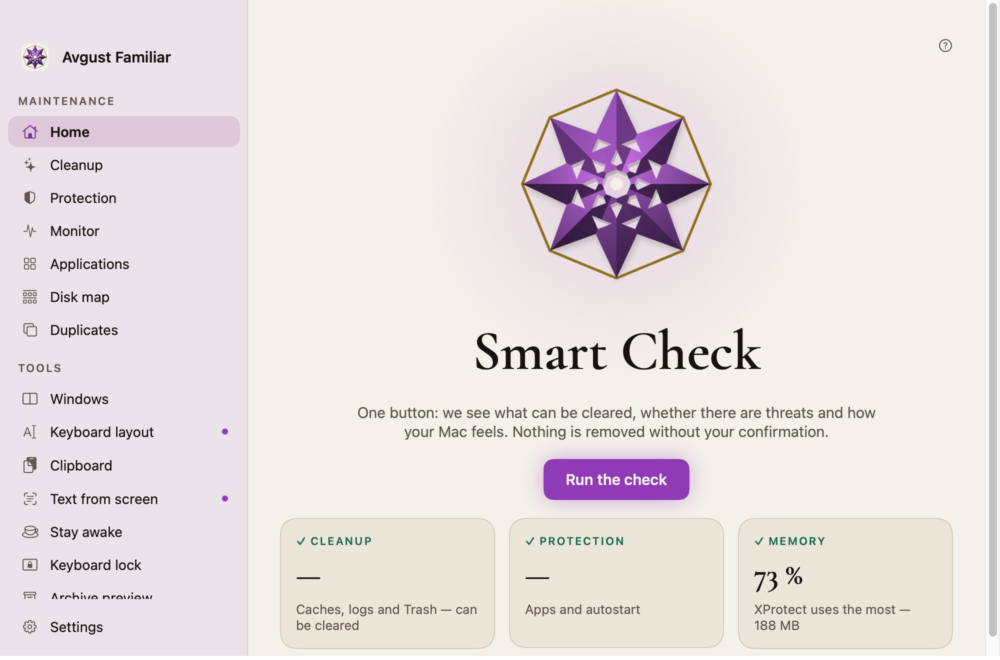
</picture>

A calm helper for your Mac that lives in the menu bar. One icon instead of a pile of small utilities: windows, keyboard
layout and snippets, clipboard, cleanup, protection, monitor, apps, disk map, duplicates, text from screen, Stay awake,
keyboard lock and archive preview. Nothing goes to the internet except the update check on GitHub.

- **Download:** [latest release](https://github.com/aaavgust/AvgustFamiliar/releases/latest) — `AvgustFamiliar-1.0.0.dmg`
- **Author’s site:** [aaavgust.github.io](https://aaavgust.github.io)
- **Feedback:** [a_a_avgust@icloud.com](mailto:a_a_avgust@icloud.com)

## What it does

| Section | What it does |
| --- | --- |
| Home | Smart check: cleanup, protection and monitor in one click |
| Cleanup | Caches, logs and temporary files in plain words, marked “safe”, “your call” or “protected” |
| Protection | Only real malware counts as dangerous; unsigned apps are listed separately and calmly |
| Monitor | CPU, memory, disk, network, sensors; only ordinary apps can be quit, never system ones |
| Applications | What you have not opened for a long time; removal together with the app’s support files |
| Disk map | What takes space in your whole home folder or on a disk you choose, as rectangles by size |
| Duplicates | Identical files, compared by content |
| Windows | Snap to screen edges and corners while dragging; shortcuts for halves, quarters and full screen |
| Keyboard layout | Fixes text typed in the wrong layout as you type; a universal key (Fn press by default); snippets with `]` |
| Clipboard | History of text, images and files; a window at the pointer with ⌘⇧V, arrows, Enter, digits 1–9 |
| Text from screen | Select an area and its text lands on the clipboard |
| Stay awake | Keeps the Mac awake: for a while, until a given time, or while a chosen app runs |
| Keyboard lock | Turns the keyboard off for a moment so you can wipe it |
| Archive preview | ZIP, TAR, 7z, RAR and more — contents with the space bar, without unpacking |

More screenshots

| | |
| --- | --- |
| 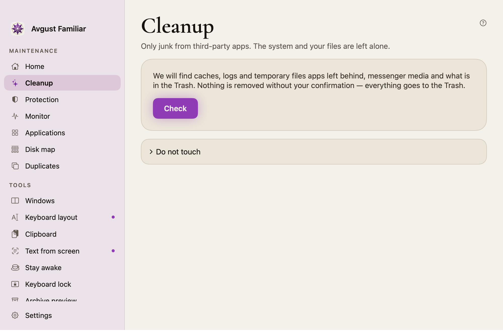 | 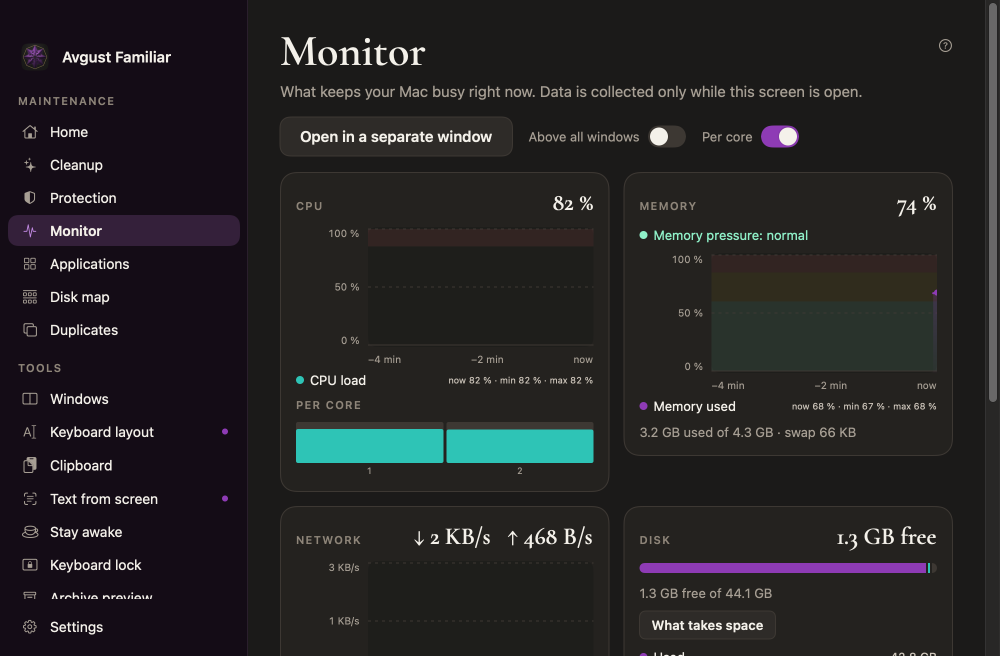 |
| 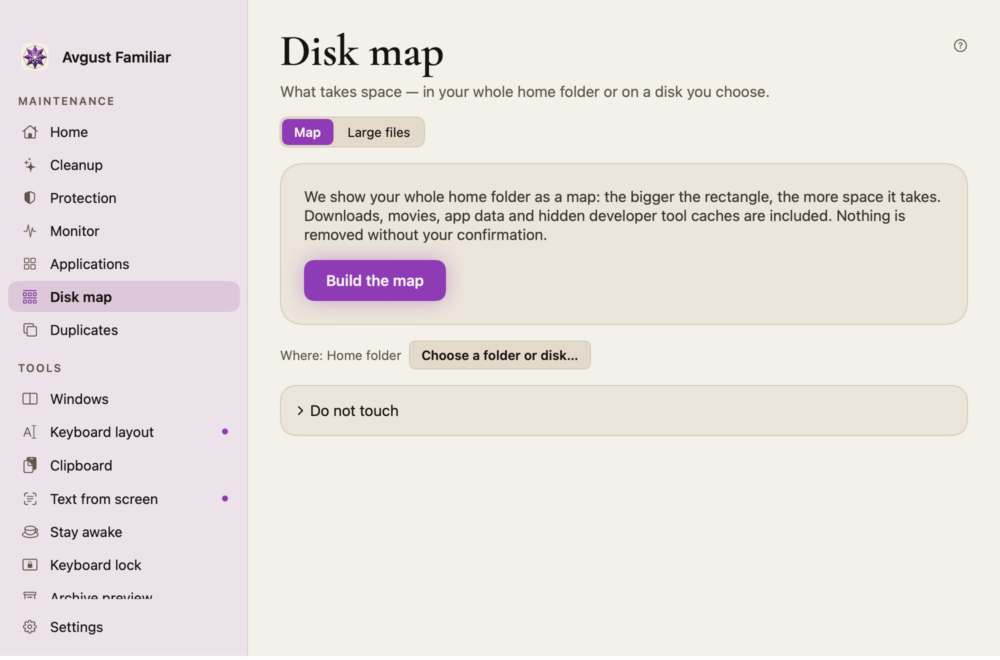 | 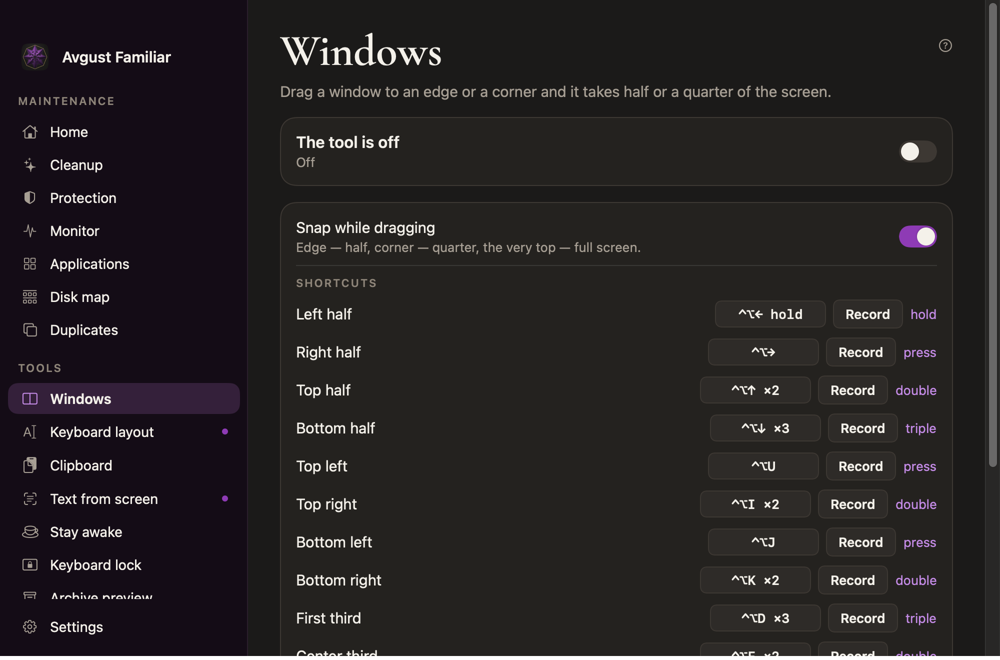 |
| 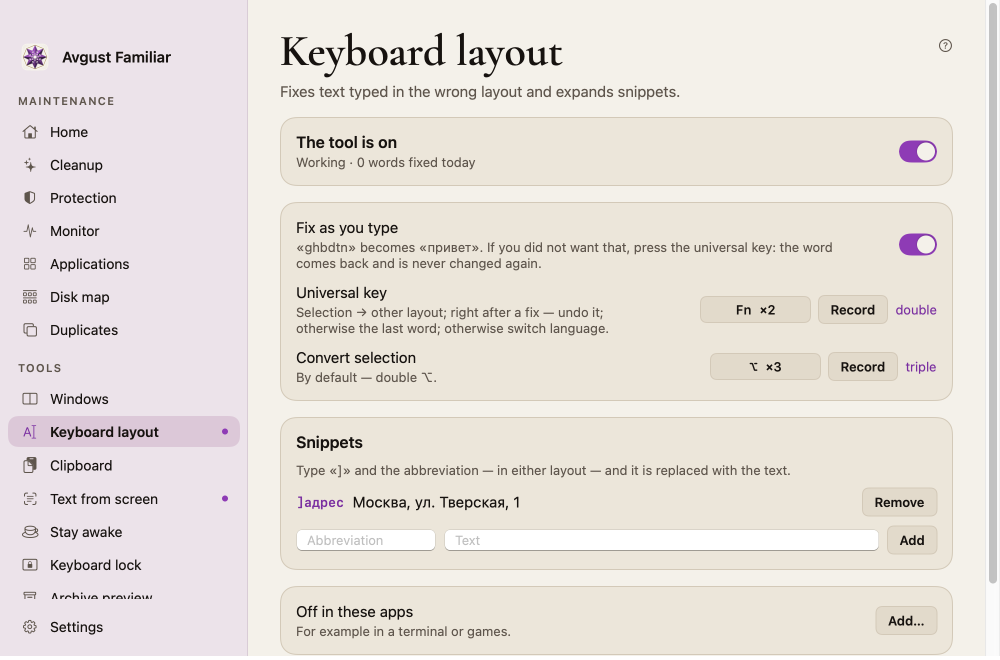 | 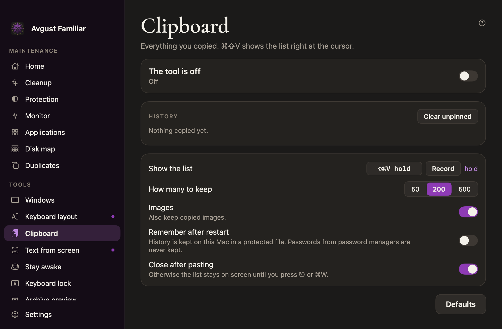 |
| 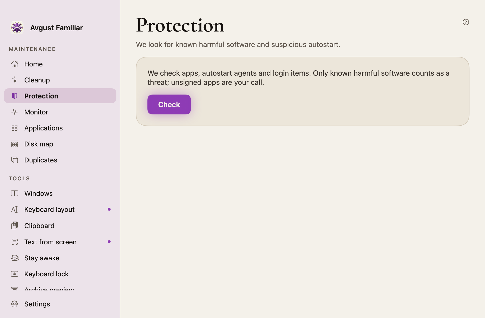 | 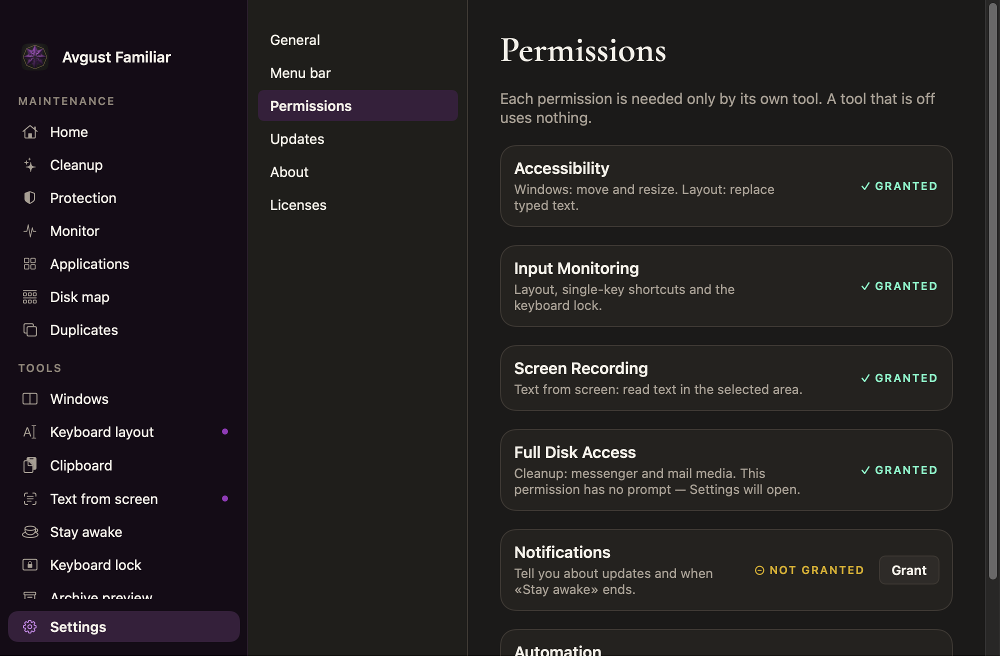 |

## System requirements

- macOS 15 Sequoia or later.
- A Mac with Apple silicon (M1 or later). **Intel Macs are not supported.**
- About 10 MB of disk space.

## Install

1. Download `AvgustFamiliar-1.0.0.dmg` from the [latest release](https://github.com/aaavgust/AvgustFamiliar/releases/latest)
   and open it. Drag **Avgust Familiar** to Applications.
2. Open Avgust Familiar from Applications. **About the signature, honestly:** the app is signed with my own certificate
   and is not notarized by Apple (that requires a paid developer membership). So on first launch macOS stops it and says
   it cannot verify the developer. This is expected — press “Done”.
3. Open **System Settings → Privacy & Security**, scroll to “Security” and press **“Open Anyway”** next to the message
   about Avgust Familiar. Confirm with your Mac password. You only do this once.
4. A welcome window guides you through language, permissions and tools. The app’s icon is in the menu bar.

The installer window screenshot is in the Russian section above.
Updates arrive by themselves: **Settings → Updates** (daily check on, automatic install off). Every update is signed with
the author’s key, and the app will not install a file signed by anyone else.

## Permissions

Only the tools you turn on need them. Grant them from the welcome window or **Settings → Permissions**; the app explains
each one and works without the ones you skip.

| Permission | Why | Tools |
| --- | --- | --- |
| Accessibility | Move windows, replace typed text, paste from the clipboard | Windows, Keyboard layout, Clipboard |
| Input Monitoring | See typed words and single-key shortcuts | Keyboard layout, Keyboard lock |
| Screen Recording | Read text in the selected area | Text from screen |
| Full Disk Access | Messenger media and mail attachments; without it such folders are simply skipped | Cleanup, Disk map |
| Notifications | Tell you about a new version and when Stay awake ends | Updates, Stay awake |
| Automation (System Events) | Read and remove login items | Protection, Applications |

## Privacy

The app collects nothing and sends nothing. Its only network access is the update check on GitHub. Settings, clipboard
history (if you turn it on) and scan results stay on your Mac. A crash report reaches the author only if you press
“Send the report to the author” yourself: a mail opens in your mail app. Details: [PRIVACY.md](PRIVACY.md).

## File safety

Nothing is deleted without your consent. Before any removal you see a summary (“2 GB · 34 items will go to the Trash”),
Cancel is the default button, and files only ever go to the Trash. Documents, Desktop, Pictures, Music, keychains,
password managers and system folders are always protected; add your own exceptions under “Do not touch”.

## Uninstall

**Settings → About → “Uninstall Avgust Familiar…”**: the app, its settings and cache go to the Trash.
Or quit the app and drag it from Applications to the Trash.

## Documents

[License](LICENSE) · [Privacy](PRIVACY.md) · [Changes](CHANGELOG.md) · [Open-source licenses](THIRD_PARTY_NOTICES.md)

Avgust Familiar is free, closed-source software. It uses open-source components under the MIT, BSD and SIL OFL licenses;
their authors, commits and full license texts are in [THIRD_PARTY_NOTICES.md](THIRD_PARTY_NOTICES.md) and in the app:
**Settings → Licenses**.
